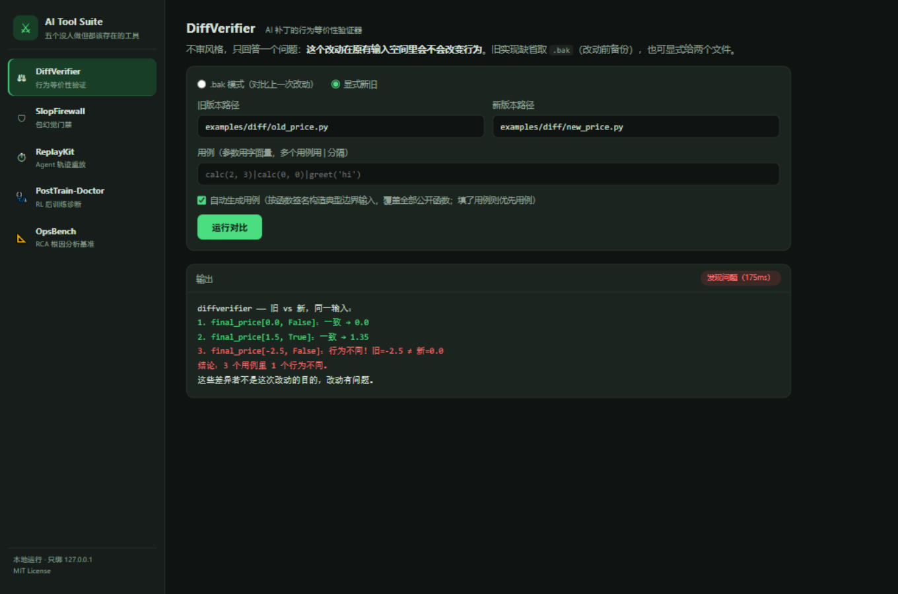

# Sentinel Suite — Five tools nobody builds, all of which should exist
# Sentinel Suite — 五个没人做但都该存在的验证/诊断工具

---

## 🇬🇧 English

**Sentinel Suite** (五个没人做但都该存在的验证/诊断工具) is a collection of five zero-dependency tools that gatekeep AI-generated work. Each tool answers one sharp question and nothing else.

**What it does**

| Tool | Question it answers |
|---|---|
| **DiffVerifier** | Will this patch change behavior on inputs the old code already accepted? (Tests green ≠ nothing changed — SWE-Proof showed ~25% of passing patches still admit counterexamples.) |
| **SlopFirewall** | Does this package name actually exist on PyPI? Blocks hallucinated / typo-squatted names before they hit `pip install`. |
| **ReplayKit** | At which step did my agent's behavior first diverge? Records tool-call traces as JSONL and replays them. |
| **PostTrain-Doctor** | Is my RL run reward-hacking? Heuristic fingerprints (RHR/NRFR proxies, length gaming, variance collapse) over episode logs. |
| **OpsBench** | How good are RCA agents, really? A neutral benchmark between "3.9–12.5% perfect accuracy" and vendor claims of "MTTR −40–58%". |

**How to use**

```bash
# 60-second tour with bundled examples (zero dependencies):
python sentinel.py demo

# Web dashboard: opens http://127.0.0.1:8642
python sentinel.py web

# Or CLI — one command per tool:
python sentinel.py diff --path src/calc.py --calls "calc(2, 3)|greet('hi')"
python sentinel.py slop scan requirements.txt
python sentinel.py replay replay trace.jsonl --tools mytools.py
python sentinel.py doctor analyze episodes.jsonl
python sentinel.py ops case-001 answer.md      # `ops --list` shows bundled cases
```

Windows: `sentinel.bat` works the same (`sentinel.bat demo`). Each tool also runs
standalone (`python diffverifier/diffverifier.py --help`). Runnable examples for all
five tools live in [examples/](examples/).

**Honest limits**: PostTrain-Doctor is heuristic, not a replication of paper metrics; OpsBench is keyword-level scoring. Every number's definition lives in the code — auditable and falsifiable. Zero third-party dependencies (pure Python 3.9+ stdlib), single-file CLIs, machine-readable exit codes, CI-ready.

> 中文说明在下方 ↓

---

## 🇨🇳 中文

LLM 生成的代码与决策正在大批进入生产环境，但验证工具没有跟上：
测试全绿 ≠ 行为没变（SWE-Proof：25% 的通过补丁仍可构造反例）；
模型推荐安装的包有 19.7% 根本不存在，而 IDE 与 CI 完全不设防；
Agent 出错只能翻日志不能重跑；RL 训练完没人回答"它是不是在骗 reward"；
RCA 产品宣称 MTTR 降一半，却没有中立尺子量过。**本仓库每个工具只补其中一块，
只回答一个尖锐的问题。**

零第三方依赖（纯 Python 3.9+ 标准库），单文件 CLI，退出码全部可机读，可直接挂进 CI，
另附本地 Web 仪表盘。



| 工具 | 回答的问题 | 立身之本 |
|---|---|---|
| [**DiffVerifier**](diffverifier/) | 这个改动在原有输入空间里会不会改变行为？ | SWE-Proof：25% 的"测试通过"补丁仍可构造出反例。所有人都在做"生成 review 意见"，没人做"证明行为没变" |
| [**PostTrain-Doctor**](posttrain-doctor/) | 这轮 RL 是不是在 hack reward？ | RHR 高达 48.1%，NRFR > RHR 说明 RL 在制造而非继承失败（arXiv 2607.09492）。TRL/verl 是训练框架不是诊断器，无人在做 |
| [**ReplayKit**](replaykit/) | Agent 从第几步开始行为不一样？ | 60% 的首次分歧发生在最前两步，行业普遍停在日志层，无事实标准 |
| [**OpsBench**](opsbench/) | RCA agent 到底行不行？（中立的尺子） | RCA agent 端到端完美准确率仅 3.9%–12.5%，而厂商宣称"MTTR 降 40–58%"。公共品，无人有商业动机做 |
| [**SlopFirewall**](slopfirewall/) | 模型说的这个包名，真的存在吗？ | 包幻觉率 19.7%、43% 稳定复现，共享幻觉包名尚未被注册；IDE 与 CI 完全不设防 |

## 快速开始

### 方式零：一分钟演示（开箱即用）

```bash
python sentinel.py demo        # 用 examples/ 自带示例依次跑通五个工具
```

Windows 下双击或命令行用 `sentinel.bat demo` 效果相同。所有示例在
[examples/](examples/) 里，跑完可以直接改着玩。

### 方式一：本地 Web 前端（推荐）

```bash
python sentinel.py web         # 自动打开 http://127.0.0.1:8642
```

单页仪表盘：左侧五个工具，填参数点运行，报告即时着色（绿=通过、红=发现问题、黄=无法判定）。
只绑定 127.0.0.1（工具会在本机读文件/执行被测代码，不要暴露到局域网）。

### 方式二：命令行

```bash
# 1) 改动行为验证：对比 .bak（改动前）与当前文件在相同输入下的行为
python sentinel.py diff --path src/calc.py --calls "calc(2, 3)|greet('hi')"

# 2) 包幻觉门禁：装包之前核一遍
python sentinel.py slop scan requirements.txt

# 3) Agent 轨迹重放：定位首次分歧步
python sentinel.py replay replay trace.jsonl --tools mytools.py

# 4) RL 训练诊断：reward hacking 指纹
python sentinel.py doctor analyze episodes.jsonl

# 5) RCA 基准：给 agent 的根因分析打分（--list 看自带案例；case-001 自动解析路径）
python sentinel.py ops case-001 answer.md
```

每个工具也能脱离入口单独运行（如 `python diffverifier/diffverifier.py --help`）。

## 测试

```bash
python tests/run_tests.py      # 五个工具的回归
python tests/test_web.py       # Web 前端 API 冒烟（自动起停服务）
```

## ⚠️ 诚实声明（先读这个）

- v0.1 的 PostTrain-Doctor 是启发式指纹，**不是**论文指标的精确复现；OpsBench 是关键词级评分，会被同义表述漏判。语义评分层在路线图上。
- 但每个数字的定义都写在代码与输出里，**可审计、可反驳**。我们宁可标"无法确认"，不输出看起来精确的猜测。
- 各工具引用的论文数字是动机与定位；本仓库自己输出的每个数字，定义都可以审计。

## 状态

- DiffVerifier、SlopFirewall、ReplayKit：**可用**。v0.1 新增：DiffVerifier 签名感知自动用例（`--auto`）、SlopFirewall typosquat 检测与项目目录扫描、ReplayKit 不稳定步识别（`--repeat`）与双轨迹 `compare`。边界见各自 README。
- PostTrain-Doctor、OpsBench：**尺子立起来了**。v0.1 新增：F5 奖励方差塌缩、F6 长度-奖励相关、复查样本导出（`--export`）；第二个 RCA 案例（case-002 连接泄漏）与评分文本归一化。仍是启发式与关键词级评分——论文指标的精确复现、语义评分层在路线图上。我们不伪造精确度。

## 贡献

最被需要的贡献是**数据**：SlopFirewall 的实测幻觉包名种子、OpsBench 的新案例——见 [CONTRIBUTING.md](CONTRIBUTING.md)。代码 PR 同样欢迎，红线是"不给启发式披精确的外衣"。

## 许可

MIT（见 LICENSE）。
